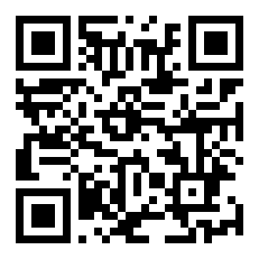

# Multiphone

Static GitHub Pages hub of small multi-phone web apps.

[**dn-scribe.github.io/multiphone**](https://dn-scribe.github.io/multiphone/) — scan to open it on another phone:

- `index.html`: home page that lists the apps from `apps.json`, and shows a
  QR code (generated client-side) of its own URL, so it can be shared to
  another phone by scanning
- `assets/qr-home.png`: static QR code for the live site, embedded above
- `apps/<id>/index.html`: one self-contained app per folder
- `apps/<id>/REQUIREMENTS.md` + `apps/<id>/adr/`: each app tracks its own
  requirements and architecture decision records (ADRs) alongside its code.
  A folder can exist with just these (no `index.html` yet) while an app is
  still being planned.
- `shared/`: shared CSS and JS
  - `shared/multiphone.js`: cross-phone networking helper (one phone hosts,
    others join with a short room code; messages go peer-to-peer over
    WebRTC via PeerJS, loaded from a CDN). See the comment at the top of
    the file for the `Multiphone.host()` / `Multiphone.join()` API. Use
    this for any app where phones need to share live state, instead of
    reinventing room codes/signaling per app.

To add an app, create `apps/<id>/` and add an entry to `apps.json`.
